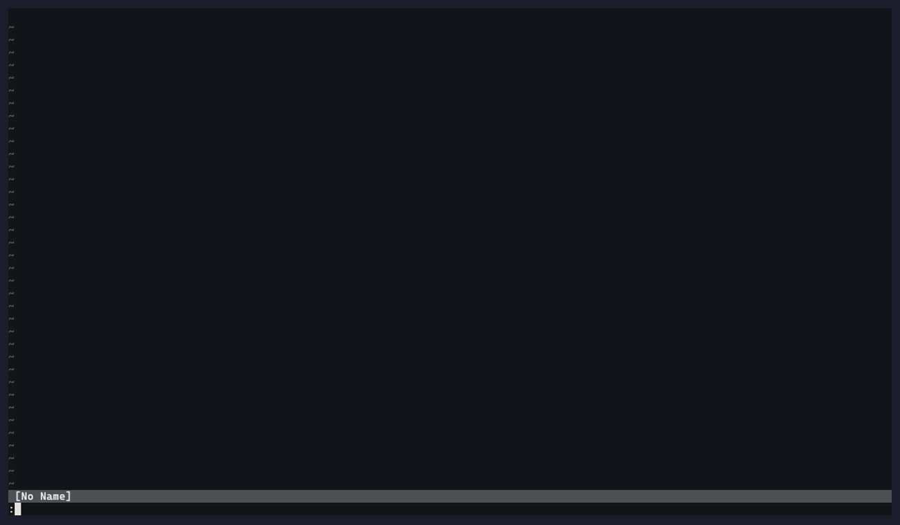
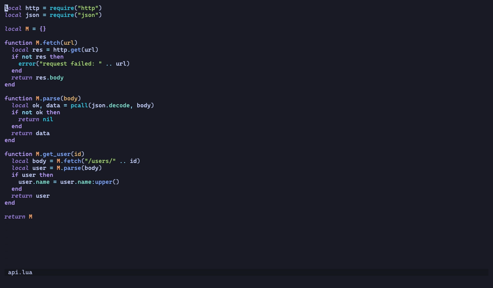

# review.nvim 🧐

Code review annotations for codediff.nvim, optimized for AI feedback loops.

Inspired by [tuicr](https://github.com/agavra/tuicr).



*A review of a diff: an issue, a praise and a range suggestion. Then `C` exports them as markdown.*

## Features

- Comments on lines of a diff, with four types: Note, Suggestion, Issue and Praise
- Comments on a range of lines
- Signs, line highlights and boxes of virtual text for each comment
- One comment store for each repository, kept across restarts
- An export to the clipboard when you close a review, then an archive of the comments
- Markdown export for AI agents, with a callback for tmux, agents or files
- A command to send the comments to [sidekick.nvim](https://github.com/folke/sidekick.nvim)
- A commit picker to review specific commits
- A branch picker to review a branch against its base. The base is automatic, or you pick it. review.nvim uses the merge base and does not check out the branch.
- Notes on any file, exported with the review comments
- Files marked as reviewed: `r` marks a file and goes to the next one, and `<Tab>` skips reviewed files
- The diff view of codediff.nvim

## Requirements

- Neovim >= 0.10
- [codediff.nvim](https://github.com/esmuellert/codediff.nvim)
- [nui.nvim](https://github.com/MunifTanjim/nui.nvim)

## Installation

The plugin follows [semantic versioning](https://semver.org/). To get only compatible updates, set `version` to a release.

With lazy.nvim:

```lua
{
  "georgeguimaraes/review.nvim",
  version = "*",
  dependencies = {
    "esmuellert/codediff.nvim",
    "MunifTanjim/nui.nvim",
  },
  event = "VeryLazy",
  keys = {
    { "<leader>rr", "<cmd>Review<cr>", desc = "Review working tree" },
    { "<leader>rc", "<cmd>Review commits<cr>", desc = "Review commits" },
    { "<leader>rb", "<cmd>Review branch<cr>", desc = "Review branch" },
    { "<leader>rn", ":Review note<cr>", mode = { "n", "v" }, desc = "Review: note here" },
    { "<leader>re", "<cmd>Review edit<cr>", desc = "Review: edit comment" },
    { "<leader>rd", "<cmd>Review delete<cr>", desc = "Review: delete comment" },
    { "<leader>rx", "<cmd>Review export<cr>", desc = "Review: export" },
  },
  opts = {},
}
```

Some notes on this snippet:

- All the `keys` start with `<leader>r`, so which-key shows them together. Do not map `<leader>r` itself. If you do, Neovim waits for the timeout before it runs the mapping.
- `<leader>rn` uses `:` and not `<cmd>`. In visual mode, `:` becomes `:'<,'>Review note`, so the same key adds single-line notes and range notes.
- `event = "VeryLazy"` loads the plugin shortly after startup. Because of this, notes from earlier sessions show when you open a file. With `cmd = { "Review" }`, notes do not show until you run `:Review` in the session. Use `cmd` only if you do not use notes.
- In the diff view, the plugin sets the single-key mappings (`i`, `d`, `e`, `C`, `q` and others). See [Keybindings](#keybindings-in-diff-view).

## Usage

```vim
:Review              " Open codediff with comment keymaps (default)
:Review open         " Same as :Review
:Review commits      " Pick commits to review
:Review commits SHA  " Review a single commit (diffs SHA^ against SHA)
:Review commits REV1 REV2  " Review a revision range (no picker)
:Review branch       " Pick a branch to review (and its base, with branch.pick_base)
:Review branch TARGET [BASE]  " Review TARGET, such as origin/feature, against BASE (no picker)
:Review note         " Add a note on the current line of any file (:'<,'>Review note for a range)
:Review edit         " Edit the comment at the cursor
:Review delete       " Delete the comment at the cursor
:Review close        " Export, archive and clear the comments, then close
:Review export       " Export the comments to the clipboard
:Review preview      " Show the export in a split
:Review sidekick     " Send the comments to sidekick.nvim
:Review list         " List all comments
:Review clear        " Archive and clear all comments
:Review toggle       " Toggle readonly and edit mode
```

## Workflow

`:Review` opens your staged and unstaged changes in a side-by-side diff. The diff opens in a new tab, with a file panel on the left. `:Review commits` lets you pick commits instead. `:Review branch` shows a list of branches, with your current branch first.

When you review your current branch, review.nvim compares the merge base with your working tree. Thus, the diff includes your uncommitted changes. When you review a different branch, such as `origin/feature-x`, review.nvim compares commits and does not check out the branch.

The base is `origin/HEAD`, `main` or `master`. To use a different base, set `branch.base` or give the base as the second argument. To pick the base from a list after the target, set `branch.pick_base = true`. `:Review branch TARGET [BASE]` never opens a picker.

`<Tab>` and `<S-Tab>` move between files. `f` shows or hides the file panel. `t` switches between the side-by-side layout and the inline layout. `<C-w>h` and `<C-w>l` move between the old (left) pane and the new (right) pane.

To add a comment, press `i` on the line and pick a type from the menu: note, suggestion, issue or praise. The comment box is a markdown buffer, so your `FileType markdown` settings, such as spell check, apply there. The comment shows as a box below the line, with an icon in the sign column.

For a comment on many lines, select the lines in visual mode and press `i`. For a comment on the whole file, press `F`. A comment on the left side shows only on the left side. A comment on the right side shows only on the right side.

When you finish a file, press `r`. The file gets a ✓ in the file panel, and the review goes to the next unreviewed file. `<Tab>` and `<S-Tab>` also skip reviewed files. To go to every file, reviewed or not, use `]f` and `[f` from codediff. Press `r` on a reviewed file to remove the mark. A mark stays only while the file is the same. If the file changes, the mark goes away.

`]n` and `[n` go to the next comment and the previous comment. `e` edits the comment at the cursor, and `d` deletes it. `c` shows a list of all the comments in all the files. Pick a comment to go to it.

`C` copies the comments to the clipboard as markdown and shows a preview. `q` exports one more time, archives the comments and closes the review. The next review then starts empty. Paste the markdown into Claude Code, sidekick.nvim (`S`) or a different tool. The export looks like this:

```
1. **[ISSUE]** `src/api.ts:23` - This endpoint does not handle errors
2. **[SUGGESTION]** `src/utils.ts:~10` - The old implementation was cleaner
```

A `~` before the line number means the old (left) side of the diff.

## Notes on any file



*Notes added while reading files, with no diff open. The notes show in the review and in the export like all other comments.*

You do not need a diff to add a comment. Run `:Review note` on a line of a file in the repository to open the comment popup. For a visual selection, use `:'<,'>Review note`. Notes show in the buffer while you read. They also show in the diff when you open a review, and they go into the same export as the other comments.

`:Review edit` and `:Review delete` work at the cursor in all buffers. `:Review list` also works with no diff open: pick a note to open its file at that line. Outside the diff, there are no default keymaps. The [installation](#installation) snippet maps `<leader>rn`, `<leader>re` and `<leader>rd` for these commands.

Notes follow your edits. While the buffer is open, each note is attached to an extmark. When you write the file, review.nvim updates the stored line numbers. If you add lines above a note, the note stays on the same code.

review.nvim finds files in the git repository of the Neovim working directory. It refuses a note on a file from a different repository.

## How comments are stored

review.nvim keeps one comment store for each repository, in `~/.local/share/nvim/review/` (the Neovim data directory). Comments stay after a restart, so you can stop a review and continue it later.

`q` (or `:Review close`) ends a review round. It exports the comments, moves the store to `archive/` with a timestamp and starts an empty store. `C` and `:Review export` only export, so you can examine the output during the review. `:Review clear` also archives the store. Archived files stay for 30 days.

The store is for each repository, not for each branch. Thus, comments from a different branch stay in the store when you open a review on your branch. review.nvim tells you when this occurs ("Comments made on other branches: 2 from feature-x"). `:Review clear` removes these comments.

The reviewed marks are in a second file next to the store. `q` and `:Review clear` remove them with the comments. `C` keeps them. A mark is for the exact contents of both sides of the diff. If one side changes, the mark no longer applies.

`export = { clear_on_close = false }` keeps the comments after you close the review. Versions before 1.10 worked like this. The first time you run this version, review.nvim copies the old per-branch file of your current branch into the new store.

## Keybindings (in diff view)

**Readonly mode** (default):
| Key | Action |
|-----|--------|
| `i` | Add a comment (pick the type from a menu) |
| `F` | Add a comment on the whole file |
| `r` | Mark the file as reviewed and go to the next unreviewed file (press again to remove the mark) |
| `d` | Delete the comment at the cursor |
| `e` | Edit the comment at the cursor |
| `c` | List all comments |
| `f` | Show or hide the file panel |
| `R` | Toggle readonly and edit mode |
| `<Tab>` | Next unreviewed file |
| `<S-Tab>` | Previous unreviewed file |
| `]f` / `[f` | Next file and previous file, including reviewed files (from codediff) |
| `]n` | Next comment |
| `[n` | Previous comment |
| `C` | Export to the clipboard and show a preview |
| `S` | Send the comments to sidekick.nvim |
| `<C-r>` | Archive and clear all comments |
| `q` | Close: export, then archive and clear the comments |
| `t` | Toggle the side-by-side and inline layouts |
| `?` | Show the review.nvim help |
| `g?` | Show the codediff help |

**Edit mode** (when `codediff.readonly = false`):
| Key | Action |
|-----|--------|
| `<localleader>cc` | Add a comment (pick the type from a menu) |
| `<localleader>cn/cs/ci/cp` | Add a Note, Suggestion, Issue or Praise |
| `<localleader>cf` | Add a comment on the whole file |
| `<localleader>cr` | Mark the file as reviewed (press again to remove the mark) |
| `<localleader>cd` | Delete the comment |
| `<localleader>ce` | Edit the comment |

**Comment popup** (when you add or edit a comment):
| Key | Action |
|-----|--------|
| `Enter` | Insert mode: add a new line. Normal mode: submit the comment |
| `Ctrl+s` | Submit the comment |
| `Tab` | Go to the next comment type |
| `Esc` / `q` | Cancel (normal mode) |

## Configuration

To disable a keymap, set it to `false`.

**Keymap options**
| Option | Default | Action |
|--------|---------|--------|
| `add_comment` | `<localleader>cc` | Add a comment, pick the type (edit mode) |
| `add_note` | `<localleader>cn` | Add a note (edit mode) |
| `add_suggestion` | `<localleader>cs` | Add a suggestion (edit mode) |
| `add_issue` | `<localleader>ci` | Add an issue (edit mode) |
| `add_praise` | `<localleader>cp` | Add a praise (edit mode) |
| `add_file_comment` | `<localleader>cf` | Add a comment on the whole file (edit mode) |
| `toggle_reviewed` | `<localleader>cr` | Mark the file as reviewed, or remove the mark (edit mode) |
| `delete_comment` | `<localleader>cd` | Delete the comment (edit mode) |
| `edit_comment` | `<localleader>ce` | Edit the comment (edit mode) |
| `next_comment` | `]n` | Next comment |
| `prev_comment` | `[n` | Previous comment |
| `next_file` | `<Tab>` | Next unreviewed file |
| `prev_file` | `<S-Tab>` | Previous unreviewed file |
| `toggle_file_panel` | `f` | Show or hide the file panel |
| `list_comments` | `c` | List all comments |
| `export_clipboard` | `C` | Export to the clipboard |
| `send_sidekick` | `S` | Send the comments to sidekick.nvim |
| `clear_comments` | `<C-r>` | Archive and clear all comments |
| `close` | `q` | Close: export, archive and clear |
| `toggle_readonly` | `R` | Toggle readonly and edit mode |
| `show_help` | `?` | Show the review.nvim help |
| `readonly_add` | `i` | Add a comment (readonly mode) |
| `readonly_add_file` | `F` | Add a comment on the whole file (readonly mode) |
| `readonly_toggle_reviewed` | `r` | Mark the file as reviewed and go to the next unreviewed file, or remove the mark (readonly mode) |
| `readonly_delete` | `d` | Delete the comment (readonly mode) |
| `readonly_edit` | `e` | Edit the comment (readonly mode) |
| `popup_submit` | `<C-s>` | Submit the comment (popup, insert mode and normal mode) |
| `popup_cancel` | `q` | Cancel the comment (popup, normal mode) |
| `popup_cycle_type` | `<Tab>` | Go to the next comment type (popup) |

**Other options**
| Option | Default | Meaning |
|--------|---------|---------|
| `codediff.readonly` | `true` | Make the diff panes read-only and use the single-key mappings above |
| `branch.base` | `nil` | The base for `:Review branch`. With `nil`, use `origin/HEAD`, then `main` or `master` |
| `branch.pick_base` | `false` | After you pick a target, open a second picker for its base |
| `export.header` | The four-line header in [Export format](#export-format) | The text at the top of every export |
| `export.clipboard` | `true` | Copy the export to the `+` and `*` registers |
| `export.on_export` | `nil` | `function(markdown, comments)` that runs on every export |
| `export.clear_on_close` | `true` | `q` archives and clears the comments after the export |

An example setup:

```lua
require("review").setup({
  comment_types = {
    note = { key = "n", name = "Note", icon = "📝", hl = "ReviewNote" },
    suggestion = { key = "s", name = "Suggestion", icon = "💡", hl = "ReviewSuggestion" },
    issue = { key = "i", name = "Issue", icon = "⚠️", hl = "ReviewIssue" },
    praise = { key = "p", name = "Praise", icon = "✨", hl = "ReviewPraise" },
  },
  keymaps = {
    add_note = "<localleader>cn",
    add_suggestion = "<localleader>cs",
    add_issue = "<localleader>ci",
    add_praise = "<localleader>cp",
    delete_comment = "<localleader>cd",
    edit_comment = "<localleader>ce",
    next_comment = "]n",
    prev_comment = "[n",
    toggle_file_panel = "f",
  },
  codediff = {
    readonly = true,
  },
  branch = {
    base = "main",
    pick_base = false,
  },
  export = {
    header = "Review feedback:\nPlease address every comment.",
    clipboard = true,
    on_export = nil,
    clear_on_close = true,
  },
})
```

## Export format

The export is markdown for an AI chat:

```markdown
I reviewed your code and have the following comments. Please address them.

Comment types: ISSUE (problems to fix), SUGGESTION (improvements), NOTE (observations), PRAISE (positive feedback)
Lines prefixed with ~ refer to the old (left) side of the diff.

1. **[ISSUE]** `src/components/Button.tsx:23` - Wrapping onClick creates a new function every render
2. **[SUGGESTION]** `src/utils/api.ts:~45` - The old implementation was cleaner
3. **[PRAISE]** `src/hooks/useAuth.ts:12-18` - Clean implementation of the auth flow
```

A `~` before a line number (for example, `:~45`) refers to the old (left) side of the diff. Range comments use `start-end`.

`export.header` replaces the first four lines. A custom header also replaces the comment types and the `~` legend. If the reader needs them, explain them in your header.

## Export targets

Each export (`C`, `:Review export` and `q`) copies the markdown to the clipboard. It also calls `export.on_export` if you set it. Use `on_export` to send the export to a tmux pane, a file that an agent reads, Avante or a different tool.

```lua
require("review").setup({
  export = {
    clipboard = true,
    on_export = function(markdown, comments)
      -- send it to the pane on the right
      vim.fn.system({ "tmux", "send-keys", "-t", "right", markdown, "Enter" })
    end,
  },
})
```

`comments` is the list of comment tables (`file`, `line`, `line_end`, `side`, `type`, `text`). Use it to make your own format.

## Health check

`:checkhealth review` checks Neovim, git, codediff.nvim, nui.nvim and the clipboard. It also checks that the codediff functions that review.nvim calls exist. Thus, a version mismatch between the two plugins shows in the health check, not as an error on `:Review`.

## Tests

The tests use [mini.test](https://github.com/nvim-mini/mini.test). On the first run, `make` clones the dependencies into `deps/`.

```bash
make test        # unit tests (tests/test_*.lua)
make test-e2e    # end-to-end tests: run :Review in a child Neovim with codediff.nvim and nui.nvim
make test-all    # both
make test-file FILE=tests/test_store.lua
```

The end-to-end tests compare screenshots with the files in `tests/e2e/screenshots/`. If you change the UI on purpose, delete the screenshot and run the tests again to make a new one.

## License

Copyright 2025 George Guimarães

review.nvim uses the Apache License, Version 2.0. See [LICENSE](LICENSE) for details.
